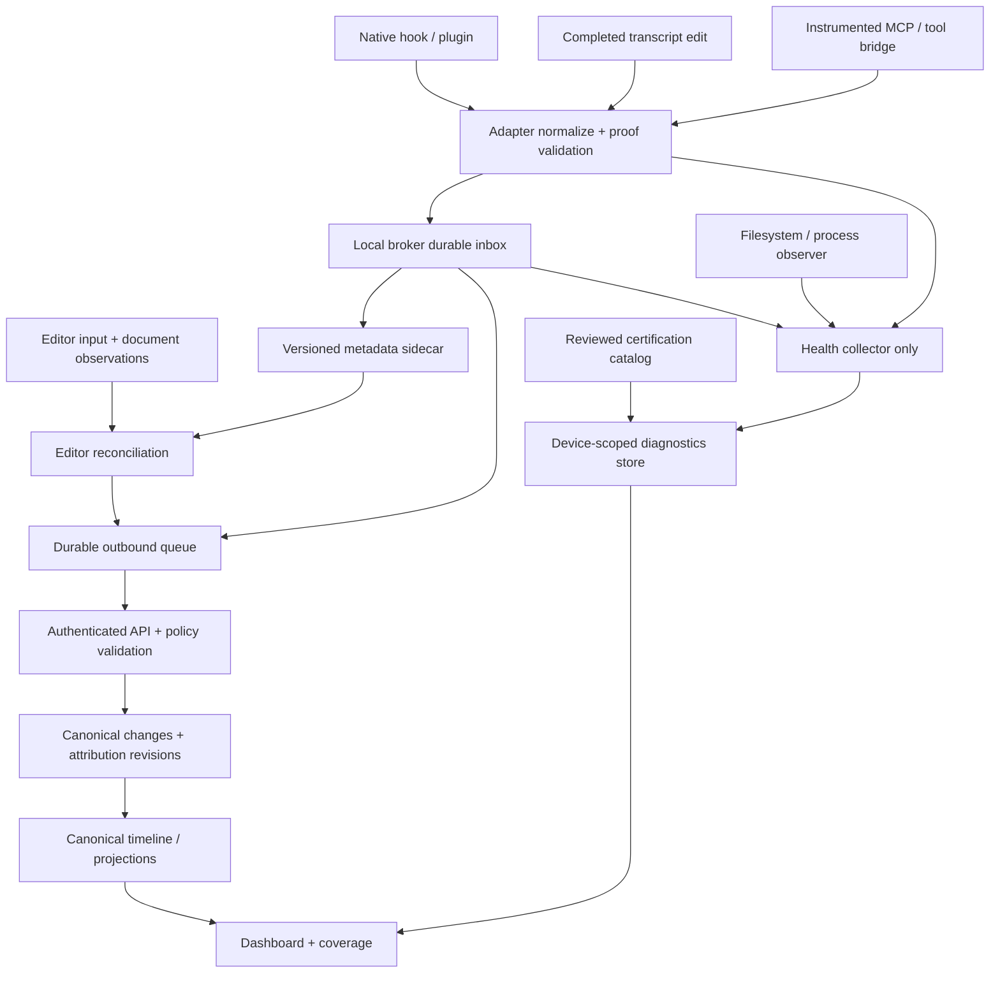

# แผนดำเนินงาน AI coding attribution และ verified coverage

วันที่: 2026-09-05 · สถานะ: แผนพร้อมแตกงาน ไม่ใช่รายงาน implementation สำเร็จ

## 1. วิธีใช้เอกสาร

เอกสารนี้แตกงานจาก [gap audit](../docs/ai-coverage-gap-audit-2026-09-05.md) ภายใต้นโยบายและลำดับ rollout ของ [ROADMAP](ROADMAP.md) และ [ADR accuracy over coverage](decision-accuracy-over-coverage.md) หากมีข้อขัดแย้งให้แก้ decision record ก่อน implementation ไม่ย้อนเปิด production inference จากแผนเก่า

ชุดเอกสารประกอบ:

- [งานย่อยและ dependency](ai-coverage-task-ledger.md): task ID, ขอบเขต, ผลส่งมอบ, เงื่อนไขปิดงาน และ effort
- [test matrix และ certification](ai-coverage-validation-plan.md): วิธีพิสูจน์ความถูกต้องและเกณฑ์ release
- [audit เดิม](../docs/ai-coverage-gap-audit-2026-09-05.md): หลักฐาน code path ที่เป็นที่มาของแผน

ข้อเท็จจริงในแผนมาจาก source ใน working tree ที่ตรวจ ไม่เท่ากับ production state และไม่เท่ากับผล test ล่าสุด งานเดิมอาจมี implementation แต่ยังต้องตรวจว่าเชื่อม runtime ครบแล้ว งานใหม่ทุก task เริ่มเป็น `planned` จนมีหลักฐาน ห้ามใช้สถานะในแผนเก่าปิดงานอัตโนมัติ

การจัดทำแผนครั้งนี้แก้เอกสารเท่านั้น ไม่ติดตั้ง agent ไม่เขียน config ผู้ใช้ ไม่รัน prompt ที่มีค่าใช้จ่าย ไม่ migrate ฐานข้อมูล และไม่ deploy

การจับคู่กับ roadmap หลัก: P0 → F0/F1, P1 → F2, P2 → F3, P3 → F4/F5; F6/F8 เป็นงาน product/release ที่สนับสนุนทุกระยะ ส่วน F7 เป็นการขยาย topology หลัง foundations ผ่านแล้ว ลำดับ agent ใหม่ยังคง Gemini → Kilo → Cursor → surveyed adapters ตาม roadmap

## 2. ผลลัพธ์ที่ต้องได้

1. เห็นการแก้ไฟล์จริงของ AI ใน tool/version/runtime/OS/edit mode ที่รับรอง แม้ไม่มี editor เปิดอยู่
2. ระบุ agent ถูกจาก native hook, structured tool/MCP event หรือ completed transcript ที่ยืนยัน file edit
3. บันทึกคน, AI, automation อื่น และ authorship ที่ยังไม่ทราบอย่างไม่ปะปนกัน โดย automation อื่นอาจเป็น reason ภายใต้ unknown ใน wire รุ่นแรก
4. ไม่บวกเหตุการณ์หรือเวลาเดิมซ้ำเมื่อ hook, transcript และ editor เห็นการแก้เดียวกัน
5. ติดตั้งครั้งเดียว ใช้ต่อได้หลังอัปเดต/restart และบอกสาเหตุที่ไม่ตรวจพบได้
6. รายงาน support matrix ตามหลักฐานจริง แยก installation, runtime health และ certification
7. เพิ่ม agent ใหม่ด้วย adapter และ tests โดยไม่ใส่ชื่อ AI กระจายทั่ว attribution/analytics core
8. รองรับพื้นที่ทำงาน remote อย่างระบุขอบเขต และมีแนวทางสำหรับเครื่องมือที่ยังไม่มีแหล่งหลักฐาน

สิ่งที่ไม่รับรอง: ตรวจผู้สร้างโค้ดจากลักษณะ source, ระบุ AI ทุกเวอร์ชัน 100%, เดา model จากชื่อ IDE, ใช้ process presence เป็นผู้เขียน, นับเวลาอ่าน/คิด/chat เป็นเวลาที่แก้โค้ด, ระบุ AI ต้นทางของ paste ที่ไม่มี provenance

## 3. Baseline ที่พบจาก source

| ส่วน | มีแล้ว | ช่องว่างที่ต้องปิด |
| --- | --- | --- |
| Event ingress | `core/src/broker.rs`, `ai/producer.rs`, CLI broker; metadata allowlist, SQLite inbox | ยืนยัน causal identity, old/new schema compatibility, retry/reconciliation ทุกทาง |
| Transcript | `claude.rs`, `codex.rs`, `gemini.rs`; CLI `supported_ai_parsers()` | เชื่อมอยู่สามตัว; Gemini ยังต้อง live-certify; ตัวอื่นต้อง survey ก่อนสร้าง parser |
| Editor | `events.ts`, `buffer.ts`, `aiAttribution.ts`, clipboard metadata | unmatched sidecar คืน human; matching ใช้เวลาและ line delta ซึ่งไม่ใช่ edit identity |
| Registry | `ai/adapter.rs` และ extension อ่าน manifest บางส่วน | CLI setup hardcode สามตัว; extension มี union/dispatch ของตัวเอง; maturity enum มีมากกว่าหนึ่งนิยาม |
| Health | `ai doctor`, `doctor ai`, `broker status`, self-test | collector กระจัดกระจาย; `ai doctor` ยังใส่ running/lag เป็นค่าคงที่ |
| Diagnostics API | routes v1, model/service ที่ wire เข้า AppState แล้ว | service เป็น in-memory HashMap ต่อ user; ไม่แยกเครื่อง; latest เทียบ clock จาก client |
| Certification | historical VERIFICATION.md และ gate ลด Verified เป็น Scaffold | handler ลดทุก Verified; ยังไม่มี lookup artifact ที่ทำให้ promote ได้จริงในเส้นทางนี้ |
| Identity | agent/provider/model และ actor fields | vendor ของ tool ปะปน model provider บาง adapter; unknown authorship ต้องแยกจาก AI ที่ไม่ทราบชื่อ |
| Observer | `feeds_production() == false` | คงไว้เป็น diagnostics; shell snapshot ต้องไม่กลายเป็นช่องลัดเปิด inference |
| Analytics | canonical timeline, AI stats/usage, dashboard | ต้องตรวจ partition unknown, coverage denominator, late correction และ projections ร่วมกัน |

หลักฐานเพิ่มจากการทำแผน: `backend/api/src/services/ai_diagnostics.rs` เก็บ report ในหน่วยความจำด้วย key=user_id; `handlers/v1/ai_diagnostics.rs::sanitize_report` ลด Verified ทุกครั้ง; `ai/adapter.rs::VerificationStatus` ต่างจาก `ai/diagnostics.rs::VerificationStatus`

## 4. ข้อตัดสินใจที่ต้องใช้ร่วมกัน

| ID | ข้อกำหนดในการพัฒนา | เหตุผล/ขอบเขต |
| --- | --- | --- |
| D01 | observer ไม่สร้างหรือแก้ attribution เสมอ | คงนโยบายหลักที่ยอมรับแล้ว |
| D02 | unknown authorship ไม่เท่ากับ Unattributed AI | เป็นรายละเอียดที่ต้องทำ ADR clarification ใน F0; ข้อความ roadmap เดิมรวม unknown กว้างเกินไปสำหรับ editor fallback ใหม่ |
| D03 | event evidence, adapter certification และ runtime health เป็นคนละมิติ | installed ไม่ได้แปลว่า verified; certified adapter อาจหยุดทำงาน; event มีรูปทรงถูกต้องไม่ได้แปลว่า route น่าเชื่อถือ |
| D04 | รองรับเป็น tuple: agent × version × runtime × OS × edit mode | ใช้ CLI test รับรอง desktop/inline/cloud ไม่ได้ |
| D05 | ระบุ model/provider ตาม metadata ของคำขอจริงเท่านั้น | ใช้ `agent_vendor` สำหรับผู้ผลิตแอป ถ้าไม่ทราบ model provider ให้ null |
| D06 | ไม่มีหลักฐาน human ไม่ถือว่า human เพราะหา AI ไม่เจอ | ให้ unknown และคง measured activity; ไม่เพิ่ม AI โดยอัตโนมัติ |
| D07 | ไฟล์เดียวกัน เวลาใกล้กัน และจำนวนบรรทัดเท่ากัน ไม่พอยืนยันว่าเป็น edit เดียวกัน | ใช้ exact identity/version proof; correlation อ่อนใช้เพียงเลี่ยงการกล่าวอ้างเกินหลักฐาน |
| D08 | capture ทำงานแบบ at-least-once; canonical result ต้อง idempotent | ไม่อ้าง transport exactly-once; ทน crash ระหว่างแต่ละขั้น |
| D09 | late evidence แก้ attribution ได้โดยไม่สร้างกิจกรรมใหม่ | ต้องมี revision/canonical winner และ rebuild ที่ไม่บวกซ้ำ; ไม่แก้ข้อมูลย้อนหลังด้วยเวลาหรือ line count อย่างเดียว |
| D10 | snapshot ที่มาจาก shell hook จะตั้งชื่อ AI ได้เฉพาะมี explicit file attribution proof | active session + workspace diff ยังไม่พิสูจน์ผู้เขียนเมื่อมีคน/agent อื่นแก้พร้อมกัน |
| D11 | setup/status ใช้ registry เดียว แต่ manifest อย่างเดียวไม่ใช่ parser/plugin implementation | ยังต้องมี adapter factory, installer strategy และ resources ที่ใช้งานได้จริง |
| D12 | old data/schema ต้องอ่านได้ และ rollout ต้อง server-first | versioned contracts, additive migration; ไม่แอบแก้ raw history เพื่อให้ตัวเลขสวย |

ค่าต่าง ๆ ที่ระบุว่า “เสนอ” เป็นค่าเริ่มต้นเพื่อทดสอบ ไม่ใช่ผล benchmark หรือข้อเท็จจริงของ runtime ปัจจุบัน

## 5. สถาปัตยกรรมเป้าหมาย

นำโค้ดเดิมมาใช้ต่อก่อนสร้าง abstraction ใหม่ แยก CLI main orchestration ออกจาก collector/setup/certification policy อย่างค่อยเป็นค่อยไป ไม่รวม refactor ทั่ว repository ไว้ใน PR แรก

## 6. สัญญาข้อมูลและการจัดประเภท

### 6.1 สิ่งที่ต้องแยกให้ชัด

| มิติ | ค่าทางแนวคิด | กฎ |
| --- | --- | --- |
| ผู้เขียน | human / ai / unknown | automation อื่นเก็บ reason แยก ไม่จัดเป็น AI |
| หลักฐาน | explicit_human_input / explicit_agent_edit / ambiguous / unavailable | evidence ต้องอ้างเหตุการณ์จริง ไม่ใช่จากชื่อ process |
| ชื่อ AI | agent_id หรือ null | มี direct file-edit evidence และ valid producer binding จึงตั้งชื่อ |
| ความพร้อม adapter | scaffold / installed / live_tested / verified / unsupported | projection จาก implementation, install probe และ catalog; ไม่ใช้แทน event evidence |
| สุขภาพ runtime | healthy / idle / degraded / unavailable / disabled | ไม่มี AI edit วันนี้อาจแค่ idle ไม่ใช่ broken |
| Line counts | exact number / null | 0 = วัดแล้วไม่มี; null = วัดไม่ได้ |
| เวลา | observed interval / unknown duration | event พิสูจน์ edit ไม่ได้แปลว่ารู้ระยะเวลา ห้ามกำหนดเวลาเต็ม session |

ไม่เพิ่ม enum ทุกตัวลง heartbeat ทันที F0 ต้องทำ wire mapping ของ fields เดิมให้ครบก่อน แล้วเพิ่มเฉพาะข้อมูลที่ขาดจริง แบบ negotiated/additive contract

### 6.2 ตารางตัดสิน attribution

| เหตุการณ์ | ผลที่ต้องได้ |
| --- | --- |
| native file-edit success พร้อม file/tool/session identity และ producer route ที่ตรวจได้ | AI; ตั้ง agent ที่มีหลักฐาน; model null ได้ |
| completed transcript มีผลแก้ไฟล์จริง | AI ตามหลักฐาน; ไม่ถือคำบรรยายของโมเดลว่าทำแล้วเป็น success |
| มีหลักฐานว่า AI แก้ แต่ metadata ระบุชื่อหาย/ขัดกัน | Unattributed AI; ไม่เลือกชื่อจากความใกล้ของเวลา |
| document change ที่ผูกกับ human input ได้ตาม capability ของ editor | Human เฉพาะ change ที่ผูกได้ ไม่เหมาทั้ง batch/file |
| document change ที่ไม่ทราบต้นทาง | Unknown authorship; ไม่เพิ่ม AI/human line total |
| formatter, refactor command, paste ที่ไม่มี AI provenance | Unknown/automation/paste reason ตามหลักฐาน; ยังบันทึกกิจกรรมผู้ใช้ที่วัดได้แยกกัน |
| มี agent process เปิดอยู่ และไฟล์เปลี่ยน | diagnostics เท่านั้น ไม่มีชื่อ AI จาก observer |
| tool ล้มเหลวและไม่มี successful per-file result | ไม่สร้าง successful AI edit; residual mutation ที่ยังไม่ทราบผู้เขียนอยู่ใน diagnostics |
| tool ล้มเหลวแต่มี explicit successful per-file result ก่อน failure | เก็บเฉพาะผลสำเร็จที่พิสูจน์ได้ พร้อม partial status หาก schema รองรับ |

นิยาม “human input ที่พิสูจน์ได้” ต้องทำ capability spike ใน VS Code ก่อนเลือก implementation: `onDidChangeTextDocument`, selection, save หรือ insert 1 ตัวอักษรเพียงอย่างเดียวไม่ใช่หลักฐานเด็ดขาด ห้ามสัญญาว่า API ที่ไม่มีอยู่จะบอกผู้แก้ได้ ไม่เพิ่ม global keyboard hook เพื่อแก้ปัญหานี้

### 6.3 Identity และ versioning

Logical fields ที่ต้องประเมินกับ schema เดิม: `event_id`, `operation_id/tool_event_id`, `session_id`, `agent_id/client_id`, `producer_id/version`, `payload_schema`, `runtime`, `device_id`, `workspace_id`, `worktree_id`, `file identity`, `change_kind`, `event_time`, `ingested_at`, `evidence_kind`, `model_provider`, `model`, `line_counts`, `revision` และ reason code

- ความซ้ำภายใน producer: stable ID ต้องคงเดิมเมื่อ retry และ distinct ต่อ file mutation; หลาย operation ในไฟล์เดียวจาก tool call เดียวต้องแยก sequence
- ความซ้ำข้าม producer: สร้าง alias ของ canonical operation เมื่อมี native call ID/session/file version proof ตรงกัน ห้ามใช้เวลาปัดเศษหรือ line delta เป็น dedup key
- แยก workspace root กับ Git repository identity และ worktree identity; project display name ไม่ใช่ key
- เนื้อหาและ content fingerprint ใช้ local matching เท่าที่จำเป็น; ไม่เพิ่ม source/prompt/diff/fingerprint ลง telemetry
- event ID บน wire ต้อง opaque และไม่บรรจุ path/prompt/command
- provider metadata ไม่ใช่ certification: string `source=agent_hook` ที่รับมาจาก network/local ingress ไม่ถือเป็นหลักฐาน route จริงโดยตัวมันเอง
- actor fields เดิมและ `is_ai_generated` เป็น compatibility projection จาก canonical decision เดียวกัน
- WakaTime-compatible heartbeat ที่ไม่มี provenance เพียงพอต้องคงกิจกรรมที่รับได้ตาม contract แต่ไม่ fabricate agent/model; แยก legacy imported line statistics จาก first-party verified mutations เพื่อไม่อ้างความแม่นยำเท่ากัน
- `BrokerEventV1` มี allowlist/strict validation: ห้ามส่ง field ใหม่ให้ binary รุ่นเก่าเงียบ ๆ; negotiate schema/capability ก่อน หรือ downgrade โดยไม่ตั้งชื่อ/ข้อมูลที่พิสูจน์ไม่ได้

### 6.4 Editor buffering และ late evidence

1. เก็บ pending observations เป็นราย change พร้อม document version/operation identity เท่าที่ API ให้ได้ แทนการใช้ยอดรวมทั้งไฟล์เป็นหลักฐานเดียว
2. แยก input activity/time, paste counters และ attribution line counters เพื่อรอหลักฐานได้โดยไม่ทำ human time หาย
3. Sidecar ต้องมี version, monotonically increasing local sequence และ acknowledgement/resume; ยังอ่าน sidecar เก่าได้
4. Exact match รับ ownership; ambiguous match ไม่เอางานคนไปให้ AI และไม่ส่ง duplicate ownership
5. เสนอ pending grace เริ่มที่ 15 วินาทีเพื่อ benchmark กับ scan ทุก 5 วินาที ไม่ใช่เวลาเพิ่มใน coding duration
6. เมื่อ grace หมดให้ส่ง unknown ที่มี stable observation ID; ห้ามส่ง human โดยปริยาย
7. ถ้า strong late evidence มาภายหลัง ต้อง reconcile ก่อน claim ownership ซ้ำ ใช้ canonical change/revision ที่ backend รองรับ
8. ถ้า legacy event จับคู่ไม่ได้อย่างแน่ชัด ให้คง unknown และรายงานเหตุผล; ไม่สร้าง correction โดยเดา
9. local pending/reconcile records ต้อง bounded และ survive restart; เสนอ late-reconcile retention 24 ชั่วโมงก่อนปรับจากผลทดสอบ
10. Undo/redo, whole-file overwrite, autosave และ aggregate buffer ต้องมี tests เฉพาะ ห้ามใช้ whole-file overwrite shortcut ยืนยัน ownership ของ unrelated edit

ต้องเลือกและ implement correction semantics ก่อนเปิด fallback ใหม่ใน production เพื่อไม่ย้ายปัญหาจาก human overcount ไปเป็น AI+unknown double count

## 7. ระยะ F0 — ยืนยัน baseline และล็อก contract

**ขึ้นกับ:** ไม่มี · **ผลส่งมอบ:** decision records, failing regressions, capability inventory, implementation baseline

งาน:

1. บันทึก branch/commit, dirty files, CLI/broker/extension versions โดยไม่ reset/stash งานผู้ใช้หรือสมมติว่า historical commit ใน roadmap คือ branch ปัจจุบัน
2. ตรวจ live module chain และไฟล์ที่ roadmap บอกว่ามีแล้ว; ระบุ implemented/wired/tested/live-certified แยกกัน
3. ทำ regression reproducer สำหรับ unmatched AI edit, sidecar delay, mixed human+AI และ doctor placeholders
4. ทำ ADR clarification สำหรับ D02: ข้อมูลเก่าที่ทราบว่าเป็น AI แต่ไม่มีชื่อแสดง Unattributed AI; unknown authorship ใหม่ไม่ถูกรวมเป็น AI
5. ทำ capability spike ของ editor input และ exact reconciliation; ถ้า API ให้ได้เพียง weak evidence ให้ documented unknown เป็นผลถูกต้อง
6. ระบุ protocol changes ที่จำเป็นและ compatibility fallback; เลือก canonical revision read/write ก่อนเริ่มเปลี่ยน counters
7. กำหนด benchmark fixture ขนาดเล็ก/ใหญ่, ground truth และ budgets ใน validation plan ก่อนเก็บผล

**ผ่านเมื่อ:** มี reproduction ที่ล้มเหลวตามช่องว่างจริง, decision mapping ไม่กำกวม, ทุก planned schema field มี consumer/owner/retention และรู้ว่า schema เดิมรองรับอะไรแล้ว

## 8. ระยะ F1 — แก้ attribution และ reconciliation

**ขึ้นกับ:** F0 · **ไฟล์หลัก:** core `heartbeat.rs`, `broker.rs`, `ai/event.rs`, `ai/canonical.rs`, `ai/dedup.rs`, CLI `broker.rs`, VS Code `events.ts`, `buffer.ts`, `aiAttribution.ts`, API heartbeat/timeline/AI services

งาน:

1. ทำ pure decision function และ shared truth table สำหรับ human/AI/unknown; client/server มี conformance fixtures เดียวกัน
2. แก้ editor fallback และเพิ่ม per-change pending store; ไม่ใช้ batch totals ตั้งชื่อ AI
3. ตรวจ broker identity, retry idempotency และ exact alias ข้าม hook/transcript/editor
4. เพิ่ม canonical attribution revisions เฉพาะที่ schema เดิมยังไม่มี; revision ไม่เพิ่ม active interval หรือ line changes ใหม่
5. ทำ server read semantics และ projection rebuild ให้เลือก canonical winner ก่อน aggregate; ตรวจ ClickHouse materialized views ไม่ sum ทั้ง old/new revisions
6. ทำ additive wire/database migration และ old-client compatibility; preserve raw observed metadata ที่นโยบายอนุญาต
7. แยก AI-known-name-missing กับ unknown-origin ใน API/UI contract โดยไม่บังคับให้ deprecated bool อธิบายทั้งหมด
8. ทำ crash-recovery tests ระหว่าง inbox accept, sidecar write, outbound queue, backend ack และ cursor advance

**ผ่านเมื่อ:** positive/negative/concurrency matrix ผ่าน, ไม่มี false named attribution ใน deterministic corpus, canonical totals ไม่เพิ่มเมื่อ retry/correct, ส่วน activity/time ที่ไม่ได้แก้คงเดิมตาม golden fixtures

**rollback:** ปิด adapter/เส้นทางที่ผิดและแสดง unknown; ห้าม rollback ไปใช้ guessed AI identity หรือ unmatched=human เพื่อให้ coverage ดูสูง

## 9. ระยะ F2 — Diagnostics ที่วัดจาก runtime จริง

**ขึ้นกับ:** F0 contracts; health บางส่วนทำได้ก่อน F1 เสร็จ แต่ deploy ต้องรักษา attribution boundary

1. สร้าง health collector กลางใน CLI; `ai doctor`, `doctor ai`, `ai status`, extension self-test ใช้ snapshot เดียวกัน
2. อ่าน service process/lock owner/start identity จริง, inbox/outbound state, last scan, last parse success, cursor position, last delivered event และ error code
3. `false` หมายถึง probe ยืนยันว่าไม่ทำงาน; probe ล้มเหลวต้อง unavailable ไม่ใช่ false หรือ 0
4. แยก no activity กับ parser stalled: backlog/cursor ไม่ก้าวทั้งที่มี records ใหม่จึง degraded; transcript ไม่เปลี่ยนเพราะไม่ได้ใช้ AI = idle
5. แยก consent ของ tracking adapters, diagnostic upload และ optional observer; observer ปิดต้องไม่ทำให้ hook ที่ติดตั้งแล้วถูกแสดงว่า disabled
6. รายงาน per device × adapter × runtime; ใช้ opaque installation ID ไม่ส่ง hostname/path/raw error message
7. เพิ่ม diagnostics schema รุ่นถัดไปสำหรับ nullable measurements + measured_at/availability; server รับ v1/v2 ระหว่าง rollout และ v1 zeros ที่เชื่อไม่ได้ไม่ถูกแสดงเป็น healthy
8. ย้าย in-memory latest report ไป durable repository สำหรับ production หลายเครื่อง/หลาย API instance; เสนอ PostgreSQL ถ้าตั้งค่าอยู่แล้ว ส่วน deployment ที่ไม่มี PostgreSQL ต้องระบุ ephemeral/unavailable อย่างชัดเจน
9. Durable key = authenticated user + device ID; ordering ใช้ receipt time และ per-device sequence/boot identity ไม่ใช้ client wall clock อย่างเดียว
10. จำกัดจำนวน device/adapters/payload, report cadence, TTL; เสนอเก็บ latest 30 วัน และไม่เปิด raw history เริ่มแรก
11. ย้าย validation/promotion policy ออกจาก handler ไป service; handler คง auth/shape/delegation

**ผ่านเมื่อ:** stop/start broker, offline, auth error, parser error, idle, no consent และ schema unknown แสดงต่างกัน; API restart/multi-instance/device tests ผ่านตาม deployment mode; เปิด diagnostics แล้ว heartbeat/duration output ไม่เปลี่ยน

## 10. ระยะ F3 — Registry, setup, update และ uninstall

**ขึ้นกับ:** F0; ใช้ health จาก F2 เพื่อแสดงผลที่เชื่อถือได้

1. Registry เป็นแหล่งรายการ aliases/runtimes/platforms/capabilities/installation strategy/resources/schema support เดียว
2. CLI `--all` หมายถึง adapters ที่ตรวจพบและมี install strategy ที่ใช้ได้ ไม่ใช่ติดตั้ง AI tools ทุกตัวหรือเปิด scaffold โดยไม่ระบุสถานะ
3. เพิ่ม registry-driven parser factory และ installer dispatch; ตรวจ resource bundle มีไฟล์จริงก่อนประกาศติดตั้งได้
4. Extension อ่าน typed registry/setup result จาก CLI; ลบ hardcoded lists ที่ซ้ำโดยคง backward compatibility ของ config IDs
5. แยก native plugin, structured TOML/JSON merge, passive transcript, manual/unsupported; JSON ใช้ parse/merge ห้ามแทรก marker comment แบบ TOML
6. Setup: preflight → calculate managed diff → atomic write → install/start broker → verify effective config → report per adapter
7. ไม่ขอ consent ซ้ำเมื่อมีการยินยอมที่ยังครอบคลุมอยู่; setup ของ adapter ใหม่หรือ diagnostics upload ต้องสะท้อนการตัดสินใจผู้ใช้ที่มีจริง
8. ระหว่าง upgrade ต้องใช้ stable versioned bundle + active pointer, checksum/version validation และ rollback ที่ไม่ชี้เข้า VSIX เก่าซึ่งถูกลบ
9. Lock การติดตั้งพร้อมกันจาก CLI/extension; preserve user hooks และไฟล์ที่ผู้ใช้แก้เอง; corrupt config ไม่ overwrite
10. Uninstall ลบเฉพาะ managed entries/assets ที่ไม่มี reference, ไม่ลบ AI tools, transcript, API config หรือ metrics history โดยปริยาย
11. ทดสอบ launchd/systemd/Windows service strategy จริงและ dependency เช่น shell/jq; package matrix ที่มี binary ไม่เท่ากับติดตั้ง hooks ได้บน OS นั้น
12. `--json` ต้องมีผลแยก installed/skipped/unsupported/failed และ suggested action; batch partial failure ไม่คืน success ทั้งหมด

**ผ่านเมื่อ:** install/setup/update/uninstall ซ้ำได้, user config คงอยู่, คำสั่งทุกผิวแสดงรายการเดียวกัน, offline install มีผลชัดเจน, service ทำงานหลังปิด editor

## 11. ระยะ F4 — Certification ที่ใช้งานได้จริง

**ขึ้นกับ:** F1, F2, F3 สำหรับการรับรองครบเส้นทาง

1. สร้าง schema artifact สำหรับ adapter coverage แยกจาก duration certification เดิม
2. Artifact ผูก adapter/producer/tool version, runtime, OS/arch, edit modes, schema, test corpus version, tested commit/build digest, timestamps และผล gate
3. Validator ตรวจ mandatory fields, bounds, privacy และผล test แต่ validator ไม่สร้างผล live ผ่านเอง
4. เพิ่ม reviewed certification catalog ที่ backend โหลดได้จริง; MVP ใช้ validated catalog ใน release artifact เพื่อไม่ต้องเปิด endpoint self-certify สาธารณะ
5. Service คำนวณ effective maturity จาก catalog + reported version/runtime + installation evidence; client string Verified ไม่เพียงพอ
6. ผูก runtime report กับ certificate ID/tuple ที่ตรง; certificate ของเวอร์ชันหนึ่งไม่ครอบคลุมเวอร์ชันถัดไปโดยอัตโนมัติ
7. รองรับ revoked/expired/mismatch; เสนอ recheck ทุก 30 วันสำหรับ certified tuple และทันทีเมื่อ parser/producer/tool schema เปลี่ยน โดย maturity กับ historical event evidence แยกกัน
8. Import หลักฐาน Claude/Codex เดิมเป็น historical record; ข้อมูลที่ขาดให้ missing และรันเติม ไม่กรอก tool version/ผลทดสอบแทน
9. UI ใช้ capability-scoped Verified เช่น “CLI file edits ผ่านทดสอบ”; ไม่แสดง Verified ทั้งผลิตภัณฑ์เมื่อ Tab/cloud ยังไม่ผ่าน
10. Artifact ต้องไม่บรรจุ prompt/source/diff, personal paths, account IDs, secrets หรือ screenshots ที่มีข้อมูลส่วนตัว

**ผ่านเมื่อ:** certificate จริงที่ผ่าน gate ทำให้ server แสดง verified ได้, client fake/tuple mismatch ถูกลดสถานะ, revocation ใช้ได้, fixture-only result promote ไม่ได้

## 12. ระยะ F5 — Baseline agents และการขยาย coverage

### 12.1 Checklist ร่วมต่อ adapter

1. ตรวจ official hook/plugin/API/storage docs ของเวอร์ชันเป้าหมาย ณ วันที่ implement และบันทึก URL/version; ไม่ใช้ชื่อ event จากแผนเก่าเป็นความจริง
2. ยืนยัน tool/runtime ติดตั้งและ authenticated บน test environment จริง
3. ใช้ disposable repo กับ synthetic code เพื่อเก็บ real event shape โดยไม่ดึงงานส่วนตัวมาเป็น fixture
4. บันทึก file path mapping, success/no-op/failure, tool ID, timestamps, model metadata, incremental cursor semantics
5. เลือกแหล่งหลักฐาน: native callback ที่มี explicit file edit → structured tool bridge → completed transcript; อาจมีหลายแหล่งเพื่อ recovery แต่ต้อง dedup
6. สร้าง thin producer/parser โดยเรียก shared normalize/queue; ไม่ให้ agent ต้องจำคำสั่ง emit จาก prompt
7. ทำ fixture, subprocess integration และ live E2E แยกกัน พร้อม suite จาก validation plan
8. ทดสอบ shipped bundle ไม่ใช่เฉพาะ debug executable แล้ว publish certification tuple

### 12.2 ลำดับและเกณฑ์เฉพาะ

| ชุด | Adapter/runtime | งานเฉพาะก่อนรับรอง | เมื่อไม่มีหลักฐาน |
| --- | --- | --- | --- |
| Baseline | Claude Code CLI | refresh auth/live baseline; Write/Edit/overwrite/NotebookEdit ตามที่ประกาศ; shell/MCP proof; hook+transcript duplicate | คง historical record และระบุ blocker |
| Baseline | Codex CLI | reconcile registry กับ live ledger; current patch/completion shapes; nested execution paths, failed apply, rename/delete, tool call identity | จำกัด support เฉพาะ paths ที่ผ่าน |
| Baseline เพิ่ม | Codex desktop / IDE | capture event location/schema/runtime identity จริง; worktree และ CLI+desktop simultaneous | ไม่ยืม certificate CLI |
| Wave 1 | Gemini CLI | real JSON/JSONL/session storage, replace/write_file, multi-file, completion proof, shell/MCP | unverified จนรันจริง |
| Wave 2 | Kilo CLI และ VS Code | แยก runtime, `kilo`/`kilocode` aliases, tool.execute/file.edited duplicate, per-request provider/model | scaffold เฉพาะส่วนที่ยังไม่ผ่าน |
| Wave 3 | Cursor Agent | actual hook payload/path resolution, before/after call pairing, edit success, no guessed model vendor | scaffold |
| Wave 3 เพิ่ม | Cursor Tab | สำรวจ acceptance callback/record เฉพาะ Tab และ partial accept; reject suggestion ไม่เป็น edit | unsupported edit mode หากไม่มีหลักฐาน |
| Wave 4 | Cline/Roo/Continue | survey native events และ storage, partial writes, checkpoint/restore, concurrency ใน shared extension host | unsupported/unverified พร้อมเหตุผล ไม่สร้าง parser จากการเดา |
| Wave 5 | OpenCode/Goose/Copilot CLI | survey plugin/tool/transcript surface; session/subagent identities; native package setup | จำกัด tuple ตามแหล่งที่พิสูจน์ |
| สำรวจต่อ | Copilot IDE, Windsurf, Antigravity, editor อื่น | แยก Agent/inline/refactor/runtime, verify access และ version change | แสดงขอบเขตที่ยังไม่รองรับ |
| พักตาม roadmap | Kimi Code CLI / standalone Deep Code | มี real hook/API/transcript evidence พร้อม test environment ก่อนเลื่อนคิว | parked; provider DeepSeek ไม่เท่ากับ standalone tool |
| เส้นทางทั่วไป | Generic MCP/custom agents | instrument actual file tools; namespace producer/session/tool IDs; success/failure/no-op; child calls | ingress มีอยู่ไม่แปลว่าเห็นทุก MCP call |

ไม่ประกาศ “ทุก AI” จากจำนวน manifests ความพร้อมหนึ่งแถวต้องมีทั้ง implementation และ live certificate; ไฟล์ readonly/read tool ต้องไม่กลายเป็น edit event

### 12.3 Test access และต้นทุนการรับรอง

แยก credential/tool login requirement ต่อ runtime, ค่า subscription/API และ OS runner ที่ต้องมีออกจาก engineering effort ใน ledger เริ่ม survey/fixtures/offline harness ได้โดยไม่ต้องมีบัญชีครบทุกตัว แต่ live task ที่ยังไม่มี access ต้องเป็น blocked/unverified ไม่กรอกผลแทน

กำหนดจำนวน agent calls และ token/cost budget ต่อ live campaign ก่อนรันจริง ใช้ replay fixtures ทดสอบ negative permutations จำนวนมาก และใช้ real calls สำหรับพิสูจน์ native lifecycle/shape/delivery พร้อม sample ที่เพียงพอต่อคำกล่าวอ้างเชิงตัวเลข ไม่ต้องใช้ paid AI request ใหม่สำหรับทุก unit test

### 12.4 การเทียบกับ WakaTime แบบวัดผล

หลัง baseline ผ่าน ให้ทำ optional comparison campaign ใน synthetic project เดียวกันและช่วงเวลาที่กำหนด โดยบันทึก upstream/client versions จริง เก็บผลของแต่ละระบบแยก sink/account/project เพื่อไม่ให้ข้อมูลปนกัน เปรียบเทียบกับ ground truth เป็นหลัก แล้วแสดงว่าแต่ละระบบจับ mode ใดได้หรือพลาด ห้ามใช้ผลของ WakaTime เป็น oracle ผู้เขียนโดยอัตโนมัติ

เทียบ file mutation recall, wrong-agent/human attribution, duplicate counts และ end-to-end latency แยกจาก duration definition เพราะ WakaTime กับ canonical timeline ของ AtoAxis อาจนับช่วงว่างต่างกัน จุดหมายคือรู้ coverage gap ไม่ปรับเวลาให้ตรงด้วยการบวกช่วงที่ไม่มีหลักฐาน

## 13. ระยะ F6 — Analytics และ product experience

**ขึ้นกับ:** F1 wire semantics, F2 health, F4 maturity

1. แสดง input/human activity, attributed AI edits, Unattributed AI และ Unknown authorship ตามหลักฐานที่มี ไม่แปลงยอด unknown เป็น AI เพื่อรวมกราฟ
2. Named-agent leaderboard ใช้ชื่อที่มีหลักฐาน; tool กับ provider/model เป็นคนละ breakdown
3. คง date/timezone/project/runtime/device filters และ user-scoped query keys; summary/explorer/stats ใช้ canonical timeline เดียวกัน
4. แสดง event coverage, line-count coverage, integration health และ empirical recall คนละตัว; ไม่มี ground truth ให้ไม่รายงาน recall
5. Health panel แยก Installed / Last event / Last delivery / Tested coverage / Needs action; inactive agent ไม่แสดงแดงเพราะไม่มีงาน
6. หน้าตั้งค่าแสดงตรวจพบแต่ยังไม่ได้ติดตั้ง, unsupported mode, consent disabled, auth failed, outdated schema, offline queue และวิธีแก้เฉพาะสาเหตุ
7. API data unavailable/error/empty ต้องต่างกัน และ zero ต้องหมายถึงวัดแล้วไม่มี ไม่ใช่ request ล้มเหลว
8. ใช้ UI components เดิมก่อนเพิ่มหน้าใหม่; ไม่แทรก parser/schema jargon ใน flow ผู้ใช้ เว้นแต่เปิด advanced details
9. Certification เป็นหลักฐานของ integration ไม่ใช่ security attestation หรือการรับรอง productivity ของโค้ด

**ผ่านเมื่อ:** API/UI contract และ partition tests ตรงกัน, user switch ไม่ค้างข้อมูลคนก่อน, UI ระบุ coverage ไม่เกิน tuple ที่ผ่าน, corrections ไม่เพิ่ม total time

## 14. ระยะ F7 — Remote, cloud และ editor coverage เพิ่มเติม

1. ทำ topology inventory: local editor/local agent, local editor/SSH agent, WSL, dev container, remote extension host, desktop worktree และ cloud job
2. Collector ต้องอยู่ฝั่งที่เห็น file mutation และ transcript จริง; local desktop tracker ไม่ใช้แทน remote collector
3. Transport ส่ง metadata ผ่าน authenticated API/approved bridge; ไม่ expose local broker สาธารณะเพื่อให้ cloud เข้ามาได้ง่าย
4. กำหนด device/container session identity ที่ stable ข้าม restart ตาม lifecycle แต่ไม่รวม clone ใหม่ผิดเครื่อง; rotate/retire IDs ได้
5. จับคู่ repository/worktree/workspace จาก metadata ที่ชัดเจน; mount path ต่างกันใช้ explicit mapping ไม่เทียบ basename
6. Remote path และ user home ไม่อยู่ใน diagnostics; file telemetry ใช้นโยบาย path เดิมของผลิตภัณฑ์โดยไม่ขยายข้อมูลที่ส่ง
7. ทดสอบ clock skew, reconnect, duplicate local+remote collection, container teardown ก่อน flush และ backend outage
8. Cloud agents ต้องมี job/tool-level evidence; commit/PR bot author อย่างเดียวใช้เป็น imported VCS metadata ไม่รับรองทุกบรรทัดว่า AI เขียน
9. Browser paste: คง unknown ถ้าไม่มี provenance; browser content/clipboard integration เป็นงานแยกและไม่เพิ่ม permission โดยปริยาย
10. JetBrains/Neovim/Zed/LSP และ editor อื่นเป็นตัวรับ metadata sidecar/producer ตาม capability จริง; generic LSP document change ไม่บอกผู้เขียนโดยอัตโนมัติ

**ผ่านเมื่อ:** แต่ละ topology ผ่าน positive/negative/dedup/disconnect suite และมี certificate แยก; ไม่ให้ remote uncertainty บล็อก release ของ local tuple ที่ผ่านแล้ว

## 15. ระยะ F8 — Release, compatibility และการดูแลต่อ

### 15.1 ลำดับปล่อย

1. Schema/reader compatibility และ canonical revision store ฝั่ง server
2. Diagnostics ingestion/catalog readers และ frontend ที่อ่าน old/new responses ได้
3. Broker/CLI ที่อ่าน old producer และส่ง new schema เมื่อ server capability รองรับ
4. Extension pending/reconciliation + setup resource bundles
5. Certified adapters เปิดทีละ tuple; ยังไม่เปิด unknown producer paths
6. Rollup reprocess เฉพาะช่วง/tenant ที่จำเป็น เมื่อ read semantics พร้อมแล้ว

ทุก migration ต้อง idempotent, additive และเชื่อมจาก runtime migration owner จริง ไม่ใช้ SQL snapshot ที่ไม่มีคนเรียก รักษา handler → service → repository และ app wiring

### 15.2 Rollout stages

| Stage | ขอบเขต | ประตูเลื่อนไปขั้นถัดไป |
| --- | --- | --- |
| Lab | synthetic projects + controlled fixtures | deterministic suite และ compatibility ผ่าน |
| Internal live | บัญชีทดสอบ/ทีมที่ยินยอม; real agent versions | real events ถึง dashboard พร้อม certificates |
| Opt-in beta | เปิดเฉพาะ certified tuples | เสนออย่างน้อย 7 วัน, ไม่มี false naming/duplicate duration ที่ยังไม่แก้; ข้อมูล usage พอประเมิน |
| Gradual stable | เพิ่มกลุ่มตาม capacity/observability | error/lag/queue/performance อยู่ใน budgets และ rollback ผ่าน |
| Stable | ประกาศเฉพาะ tuples ที่ผ่าน | มี catalog version, known limitations, support runbook |

จำนวนวันผ่านอย่างเดียวไม่พอ ต้องมีจำนวน scenario/event และสภาพแวดล้อมตาม test report ไม่ประกาศ global precision จาก cohort เล็ก

### 15.3 Stop และ rollback

- พบชื่อ AI ผิดใน negative case, duration ซ้ำ, source/prompt/diff หลุด wire, tenant mix-up หรือ queue สูญหาย: หยุด tuple/feature ที่เกี่ยวข้องทันที
- Rollback ใช้ previous compatible binary/catalog และ per-adapter disable; preserve durable queue เพื่อ replay ภายหลัง
- ถ้า old binary อ่าน event/schema ใหม่ไม่ได้ ต้อง drain/quarantine แบบ metadata-only หรือคง new reader ไว้ ห้าม downgrade ทับ SQLite ที่มี schema ไม่เข้ากัน
- ถอน certification ที่ผิดและแสดง degraded/unsupported; ไม่ rewrite historical identity จาก revocation อย่างเหมารวม
- แก้ประวัติผิดที่ยืนยันได้ด้วย scoped revision/reprocess พร้อม audit; ไม่ลบทั้งบัญชี
- เปลี่ยน attribution policy ต้องไม่ย้อนเปิด observer inference

### 15.4 งานต่อเนื่องหลัง release

เพิ่ม fixture จาก real version ใหม่, ตรวจ parser drift, run certification เมื่อ tool/producer/schema เปลี่ยน, ติดตาม unmatched/ambiguous/delayed events แบบไม่ส่ง source, ตรวจคิวค้างและ disk quota, recheck support docs และ catalog เป็นรอบ

นี่เป็นรายการงานดำเนินการในอนาคต ไม่ได้ตั้ง automation หรือส่ง notification จริงในรอบวางแผน

## 16. Effort, dependencies และ milestone

ประมาณการต่อไปนี้เป็น engineering effort สำหรับผู้พัฒนาเต็มเวลา 1 คนที่เข้าถึงบัญชีและ runtime ทดสอบได้ ไม่รวมเวลารอ login, paid account, upstream change หรือ CI queue; ต้องปรับหลัง F0 ไม่ใช่วันส่งมอบที่รับรอง

| Milestone | Scope | ประมาณ effort |
| --- | --- | --- |
| M0 | F0 baseline/contracts/spikes | 3–5 วันทำงาน |
| M1 | F1 attribution + revision + migration | 8–15 วันทำงาน |
| M2 | F2 diagnostics + F3 setup | 8–14 วันทำงาน |
| M3 | F4 certification infrastructure | 4–7 วันทำงาน |
| M4 | refresh Claude/Codex + Gemini CLI | 6–12 วันทำงาน |
| M5 | F6 product integration และ initial rollout | 5–9 วันทำงาน |
| M6 | Kilo/Cursor Agent | 4–8 วันทำงานต่อ runtime |
| M7 | surveyed adapters | survey 1–3 วัน + implementation/certification 3–8 วันต่อ runtime ถ้ามี evidence surface |
| M8 | F7 remote/cloud | 8–15 วันทำงานสำหรับ foundations + certification ต่อ topology |

Core MVP M0–M5 รวมประมาณ 34–62 วันทำงาน; เพิ่ม buffer 20–30% สำหรับ schema/live-runtime uncertainty หลังประเมิน baseline ไม่ใช้จำนวนวันเป็นเหตุผลลด test gates การขยายทุก runtime เป็นงานต่อเนื่อง ไม่กำหนดเส้นตาย “ทุก AI ครบ” โดยไม่ทราบ upstream capabilities

Dependency หลัก: F0 → F1; F0 → F2/F3; F1+F2+F3 → F4 → F5 live certification; F1+F2+F4 → F6 → F8 initial stable; F7 ตามหลัง identity/contracts ที่เสถียร

การอ่านคำว่า dependency หมายถึงลำดับงาน ไม่ใช่คำสั่งให้สร้าง subagents หรือ tasks ใหม่เอง

## 17. Definition of Ready / Done

Task พร้อมเริ่มเมื่อมีขอบเขตไฟล์, dependency ที่ผ่าน, acceptance scenario, environment และ contract decision ที่เกี่ยวข้อง หาก tool/API unknown ให้ task แรกเป็น survey พร้อมผล Unsupported ที่ยอมรับได้

Task ปิดได้เมื่อ implementation ถูก wire จริง, relevant automated tests ผ่าน, ไม่มี regression ที่ยังไม่ได้อธิบาย, docs/types/config samples ตรงกัน และมี evidence link ส่วน task live certification ต้องมี real run; fixture-only ไม่ปิด task นั้น

Milestone ปิดได้เมื่อ task ที่จำเป็นผ่าน, release/rollback rehearsed, generated resources ตรง source และ limitations ถูกเปิดเผย ห้าม mark ทั้ง milestone complete ถ้า real agent run ยังติด authentication แม้ code gate ผ่านทั้งหมด

## 18. ลำดับลงมือชุดแรก

1. F0: capture baseline + regression สำหรับ unmatched edit/doctor + ADR unknown clarification
2. ออกแบบ exact reconciliation และ schema compatibility ให้จบก่อนแก้ fallback
3. ทำ F1 เป็น PR ขนาดเล็กตาม ledger แล้วทดสอบ mixed human/AI และ delayed events
4. รวม health collector และ setup registry ให้ทุกผิวใช้ข้อมูลเดียวกัน
5. ต่อ certification catalog กับ backend ให้ Verified มีเส้นทางพิสูจน์จริง
6. refresh Claude/Codex และรับรอง Gemini; เมื่อผ่านจึงไป Kilo/Cursor ตาม roadmap

รายละเอียด task และ test ที่ใช้ปิดแต่ละขั้นอยู่ในเอกสารประกอบสองไฟล์ ไม่ต้องสร้าง roadmap หลักใหม่อีกชุด
